# ATOM VPN SDK demo for iOS applications
This demo application shows basic usage of the ATOM VPN SDK, to help developers build on it quickly.

## Table of Contents

- [Compatibility](#compatibility)
- [Recommendation](#recommendation)
- [How to run this Demo](#how-to-run-this-demo)
- [SDK Installation](#sdk-installation)
    - [Integrate AtomSDKBySecure](#integrate-atomsdkbysecure)
    - [Integrate AtomSDKAnalytics](#integrate-atomsdkanalytics)
    - [Integrate AtomSDKTunnel for OpenVPN (TCP &amp; UDP) Protocols](#integrate-atomsdktunnel-for-openvpn-tcp--udp-protocols)
    - [Integrate AtomWireguardTunnel for WireGuard Protocol](#integrate-atomwireguardtunnel-for-wireguard-protocol)
    - [Setup NetworkExtension for OpenVPN TCP, OpenVPN UDP &amp; WireGuard](#setup-networkextension-for-openvpn-tcp-openvpn-udp--wireguard)
- [SDK features covered in this demo](#sdk-features-covered-in-this-demo)
- [Supported Protocols](#supported-protocols)
- [Automatic Protocol selection by SDK](#recommended-protocol)
- [Getting started with the code](#getting-started-with-the-code)
    - [Enable Local Inventory support](#enable-local-inventory-support)
    - [VPN Authentication](#vpn-authentication)
    - [Delegates to register](#delegates-to-register)
    - [Persist VPN Details](#persist-vpn-details)
- [VPN Connection](#vpn-connection)
    - [Fetch Recommended Location](#fetch-recommended-location)
    - [Recommended Protocol](#recommended-protocol)
    - [Fetch Countries](#fetch-countries)
    - [Fetch Optimized Countries](#fetch-optimized-countries)
    - [Fetch Protocols](#fetch-protocols)
    - [Protocol Switch](#protocol-switch)
    - [Use Failover](#use-failover)
    - [LAN (Local Area Network)](#lan-local-area-network)
    - [How to Connect](#how-to-connect)
        - [Connection with Parameters](#connection-with-parameters)
        - [Include or Exclude Server with Nas Identifier](#include-or-exclude-server-with-nas-identifier)
        - [Connection with Dedicated IP](#connection-with-dedicated-ip)
        - [Connection with Multiple Protocols (Auto-Retry Functionality)](#connection-with-multiple-protocols-auto-retry-functionality)
        - [Connection with On Demand Custom Rules](#connection-with-on-demand-custom-rules)
- [Cancel VPN Connection](#cancel-vpn-connection)
- [Disconnect VPN Connection](#disconnect-vpn-connection)
- [Remove VPN Profile](#remove-vpn-profile)
- [Tracker / Ad Blocker](#tracker--ad-blocker)
    - [Overview](#overview-1)
    - [Enabling Tracker / Ad Blocker](#enabling-tracker--ad-blocker)
    - [Observe Connection Status and Data](#observe-connection-status-and-data)
    - [Troubleshooting](#troubleshooting)
    - [Tracker / Ad Blocker Information in Connection Details](#tracker--ad-blocker-information-in-connection-details)
- [Network Traffic Updates](#network-traffic-updates)
- [Pause / Resume VPN Connection](#pause--resume-vpn-connection)
    - [Key Rules and Conditions](#key-rules-and-conditions)
    - [Setup Tunnel Delegates](#setup-tunnel-delegates)
    - [Pause VPN delegation](#pause-vpn-delegation)
    - [Pause / Resume VPN Connection](#pause--resume-vpn-connection-1)
    - [VPN State Management](#vpn-state-management)
    - [Handle State Changes](#handle-state-changes)
    - [Pause/Resume Information in Connection Details](#pauseresume-information-in-connection-details)
    - [Error Handling](#error-handling)
- [Note](#note)

## Compatibility

Minimum requirements for building against the ATOM SDK:

* Xcode 15.3, iOS 13.0 and later
* ATOM SDK version 6.12.0 and later
* OpenVPN TCP & OpenVPN UDP: iOS 13.0, macOS 10.15, tvOS 17.0 and later
* WireGuard: iOS 15.0, macOS 12.0, tvOS 17.0 and later

## Recommendation

This demo is built and verified with the following toolchain:

* Xcode 26.6
* Swift 5
* macOS 26.6

## How to run this Demo

1. Download the project.
2. Change bundle id or enable Automatically manage signing in all the targets.
3. Replace `ENTER_YOUR_ATOM_SDK_SECRET_KEY_HERE` with your secret key in AppDelegate.m.
4. Replace `com.atom.demo.public.ios.app.packettunnelopenvpn`, `com.atom.demo.public.ios.app.packettunnelwireguard`, and `group.com.atom.demo.public.ios.app` in AppDelegate.m if you have your own bundle id and group id.

## SDK Installation

### Integrate AtomSDKBySecure

#### Installation

**Swift Package Manager (SPM)**

1. Open your project in Xcode.
2. Select `File` > `Add Package Dependencies...`
3. Enter the URL of the AtomSDKBySecure repository: `https://bitbucket.org/purevpn/atomsdkbysecure`
4. Specify the version or branch you want to use:
   - **Branch Name:** [Documentation](https://developer.apple.com/documentation/packagedescription/package/dependency/requirement-swift.enum/branch(_:))
   - **Exact Version:** [Documentation](https://developer.apple.com/documentation/packagedescription/package/dependency/requirement-swift.enum/exact(_:))
   - **Revision:** [Documentation](https://developer.apple.com/documentation/packagedescription/package/dependency/requirement-swift.enum/revision(_:))
   - **Up To Next Major Version:** [Documentation](https://developer.apple.com/documentation/packagedescription/package/dependency/requirement-swift.enum/uptonextmajor(from:))
   - **Up To Next Minor Version:** [Documentation](https://developer.apple.com/documentation/packagedescription/package/dependency/requirement-swift.enum/uptonextminor(from:))
5. Add AtomSDKBySecure to your project.

**CocoaPods**

Add the following to your `Podfile`:

```ruby
pod 'AtomSDKBySecure'
```

Then run:

```bash
pod install
```

### Integrate AtomSDKAnalytics

AtomSDKAnalytics is a separate module that implements third-party analytics for AtomSDK. AtomSDK works without it; if you do not include it, analytics events are silently ignored.

#### Overview

- **With AtomSDKAnalytics:** VPN-related events (connect, disconnect, errors, etc.) can be sent to analytics provider.
- **Without AtomSDKAnalytics:** AtomSDK behaves the same; analytics events are not sent and no errors are raised.

#### Installation

Ensure AtomSDK and AtomCore are already added as required by AtomSDKAnalytics

**Swift Package Manager (SPM)**

1. Open your project in Xcode.
2. Select `File` > `Add Package Dependencies...`
3. Enter the URL of the AtomSDKAnalytics repository: `https://bitbucket.org/purevpn/atomsdkanalytics`
4. Specify the version or branch you want to use:
   - **Branch Name:** [Documentation](https://developer.apple.com/documentation/packagedescription/package/dependency/requirement-swift.enum/branch(_:))
   - **Exact Version:** [Documentation](https://developer.apple.com/documentation/packagedescription/package/dependency/requirement-swift.enum/exact(_:))
   - **Revision:** [Documentation](https://developer.apple.com/documentation/packagedescription/package/dependency/requirement-swift.enum/revision(_:))
   - **Up To Next Major Version:** [Documentation](https://developer.apple.com/documentation/packagedescription/package/dependency/requirement-swift.enum/uptonextmajor(from:))
   - **Up To Next Minor Version:** [Documentation](https://developer.apple.com/documentation/packagedescription/package/dependency/requirement-swift.enum/uptonextminor(from:))
5. Add AtomSDKAnalytics to your project.

**CocoaPods**

Add the following to your `Podfile`:

```ruby
pod 'AtomSDKAnalytics'   # Optional - only if you want analytics
```

Then run:

```bash
pod install
```

#### Integration Steps for Resellers

**Step 1: Add the dependency**

- **Swift Package Manager:** Add the AtomSDKAnalytics package to your project.
- **CocoaPods:** Add `pod 'AtomSDKAnalytics'` to your Podfile and run `pod install`.

**Step 2: No extra code required**

Once AtomSDKAnalytics is linked to your app, AtomSDK will use it automatically. Events are forwarded to the analytics provider; you do not need to register a provider or call analytics APIs yourself.

#### Use Cases

| Scenario                         | Podfile / Dependencies                                                           | Result                                |
| -------------------------------- | -------------------------------------------------------------------------------- | ------------------------------------- |
| Reseller wants analytics         | `pod 'AtomSDKBySecure'` + `pod 'AtomSDKTunnel'` + `pod 'AtomSDKAnalytics'` | Events sent to third-party analytics. |
| Reseller does not want analytics | Only `pod 'AtomSDKBySecure'` + `pod 'AtomSDKTunnel'` (no AtomSDKAnalytics)   | Events silently ignored; no errors.   |

#### Requirements (when using AtomSDKAnalytics)

- iOS 12.0+ / macOS 10.13+ / tvOS 17.0+
- AtomSDK 6.12.0+
- AtomCore 2.2.0+
- Mixpanel SDK 5.1.2+ (or as required by the analytics implementation)

For more details, see the AtomSDKAnalytics README and the `AtomAnalyticsProvider` protocol in AtomCore.

### Integrate AtomSDKTunnel for OpenVPN (TCP & UDP) Protocols

#### Installation

**Swift Package Manager (SPM)**

1. Open your project in Xcode.
2. Select `File` > `Add Package Dependencies...`
3. Enter the URL of the AtomSDKTunnel repository: `https://bitbucket.org/purevpn/atomsdktunnel`
4. Specify the version or branch you want to use:
   - **Branch Name:** [Documentation](https://developer.apple.com/documentation/packagedescription/package/dependency/requirement-swift.enum/branch(_:))
   - **Exact Version:** [Documentation](https://developer.apple.com/documentation/packagedescription/package/dependency/requirement-swift.enum/exact(_:))
   - **Revision:** [Documentation](https://developer.apple.com/documentation/packagedescription/package/dependency/requirement-swift.enum/revision(_:))
   - **Up To Next Major Version:** [Documentation](https://developer.apple.com/documentation/packagedescription/package/dependency/requirement-swift.enum/uptonextmajor(from:))
   - **Up To Next Minor Version:** [Documentation](https://developer.apple.com/documentation/packagedescription/package/dependency/requirement-swift.enum/uptonextminor(from:))
5. Add AtomSDKTunnel to your project.

**CocoaPods**

Add the following to your `Podfile`:

```ruby
pod 'AtomSDKTunnel'
```

Then run:

```bash
pod install
```

### Integrate AtomWireguardTunnel for WireGuard Protocol

#### Installation

**Swift Package Manager (SPM)**

1. Open your project in Xcode.
2. Select `File` > `Add Package Dependencies...`
3. Enter the URL of the AtomWireguardTunnel repository: `https://github.com/AtomSDK/AtomWireguardTunnel`
4. Specify the version or branch you want to use:
   - **Branch Name:** [Documentation](https://developer.apple.com/documentation/packagedescription/package/dependency/requirement-swift.enum/branch(_:))
   - **Exact Version:** [Documentation](https://developer.apple.com/documentation/packagedescription/package/dependency/requirement-swift.enum/exact(_:))
   - **Revision:** [Documentation](https://developer.apple.com/documentation/packagedescription/package/dependency/requirement-swift.enum/revision(_:))
   - **Up To Next Major Version:** [Documentation](https://developer.apple.com/documentation/packagedescription/package/dependency/requirement-swift.enum/uptonextmajor(from:))
   - **Up To Next Minor Version:** [Documentation](https://developer.apple.com/documentation/packagedescription/package/dependency/requirement-swift.enum/uptonextminor(from:))
5. Add AtomWireguardTunnel to your project.

### Setup NetworkExtension for OpenVPN TCP, OpenVPN UDP & WireGuard

**Note: Please follow the following steps to create two NetworkExtensions, One for OpenVPN TCP & UDP and other one for WireGuard.**

1. Open your Xcode project.
2. Add your developer account to Xcode from Preferences -> Account if you didn't add before.
3. Select General tab from your app target and then set your developer account details.
4. The Xcode project must have successfully configured **AtomSDKBySecure(Version must be 6.12.0 or above)** through CocoaPods or SPM.
5. For VPN connections with OVPN Tunnel, you need to add ‘Network Extensions’ separately by adding a new target.
6. Go to File > New > Target > Select Network Extension in the iOS Section and click on Next.
   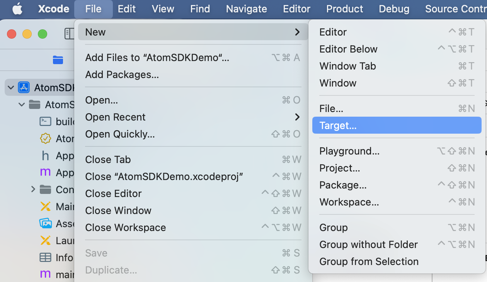
   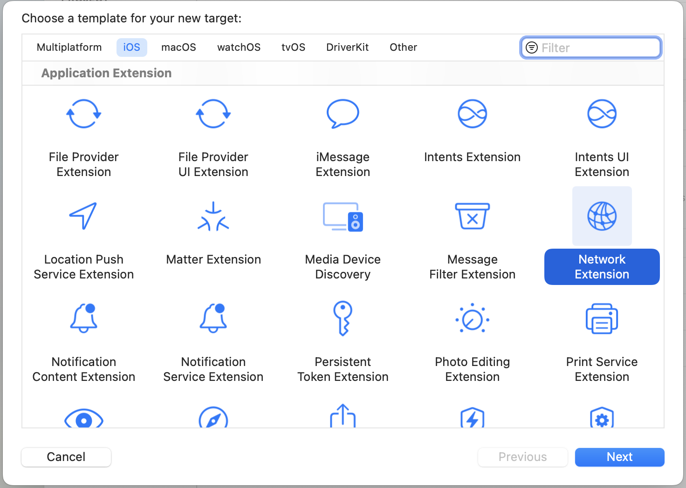
7. **Product Name:** Provide product name.
   **Team:** Select the same team on which your main app is configured.
   **Organization/Bundle Identifier:** Xcode will automatically append your product name here with the main app bundle identifier.
   **Language:** Select preferred language.
   **Provider Type:** Select Packet Tunnel as provider type.
   **Project:** Xcode will automatically select your current project.
   **Embed In App:** Xcode will automatically select your current app.
8. When clicking on Finish, it will create a new target in your project settings along with its folder in project navigator.
   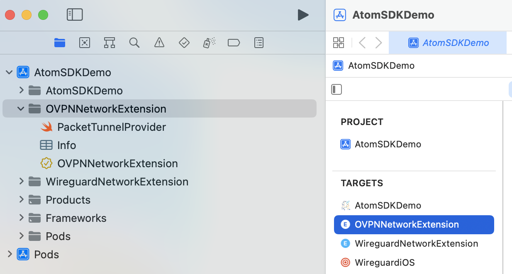
9. For VPN Connections with **WireGuard Tunnel**, repeat steps 6 to 8 and provide it a separate product name.
   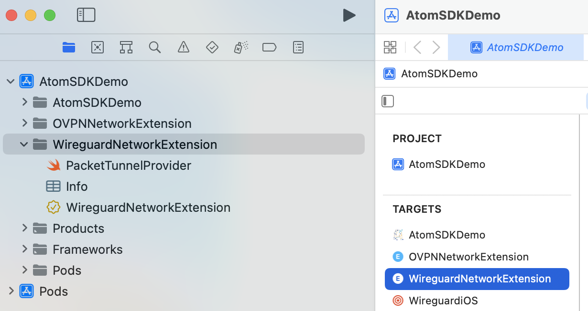
10. Make sure your **Team Name** must be the same among these targets and **Automatically managed signing** must be checked.
11. Now, the Xcode Project will have three targets. One is Main Application, Second is OvpnNetworkExtension and third is WireguardNetworkExtension.
    In each one of these, Go to project settings and select **Signing and Capabilities**, click on + **Capability**, first add **App Groups** and then add **Network Extensions**.
12. Check mark on Packet Tunnel in Network Extension capability of each of your targets.
13. Click on + icon in App Groups and provide a unique group identifier. Preferably add a prefix of ‘group’ and your bundle identifier (like group.com.atom.vpn.demo).
    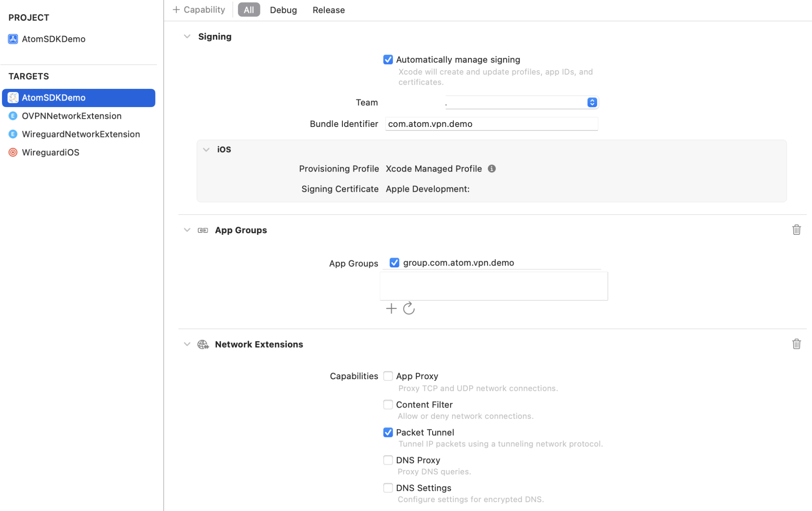
    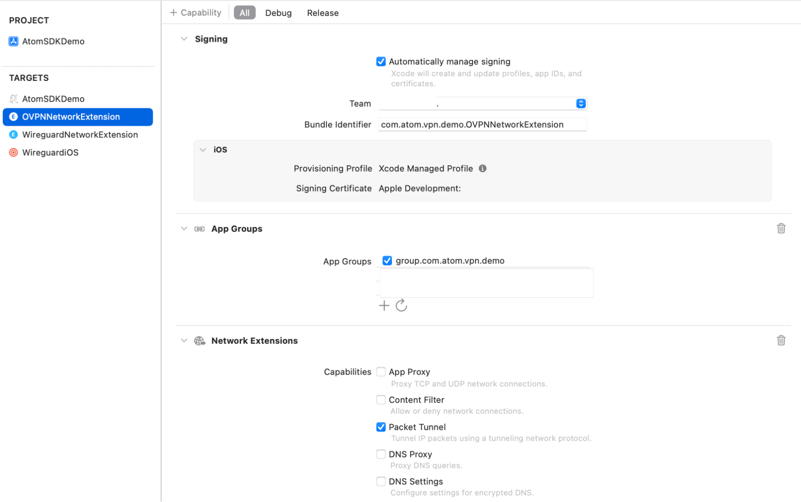
    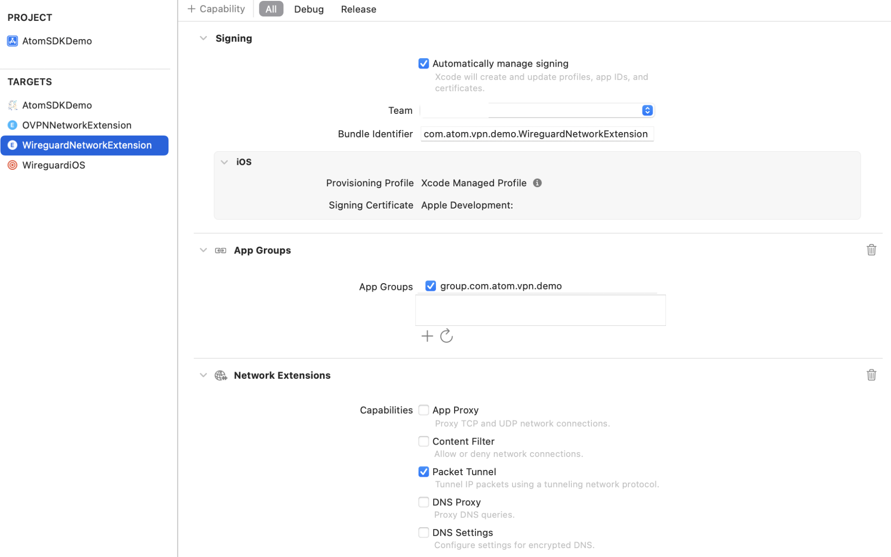
14. Now open the pod file, add a target of OvpnNetwork Extension and add ‘**pod AtomSDKTunnel**’. Run pod install.
    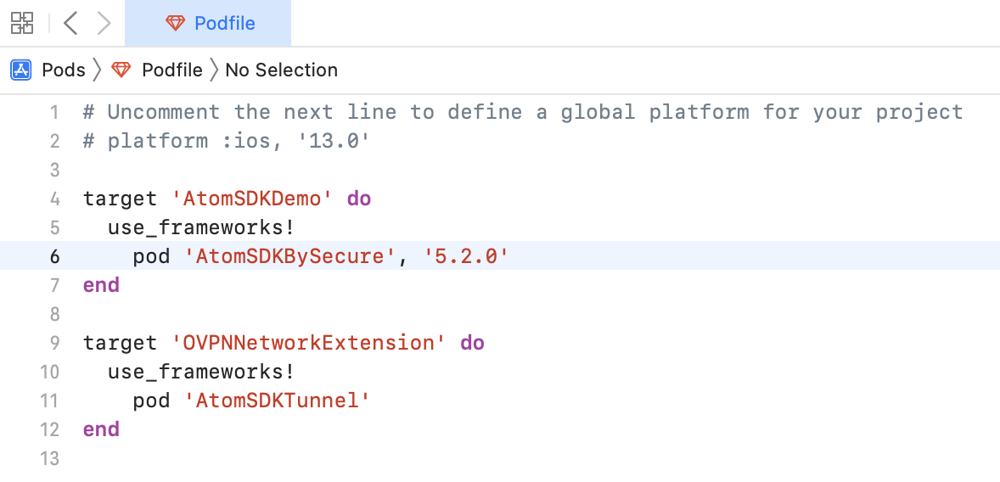
15. Go to project settings, select main project and click on Package Dependencies. By clicking on + icon, search for ‘**AtomWireguardTunnel**’ or ‘https://github.com/AtomSDK/AtomWireguardTunnel’.
16. In the **Dependency Rule**, select **Exact Version** and write **2.3.0** in the field. Select your project in **Add to Project**. Click on **Add Package**.
    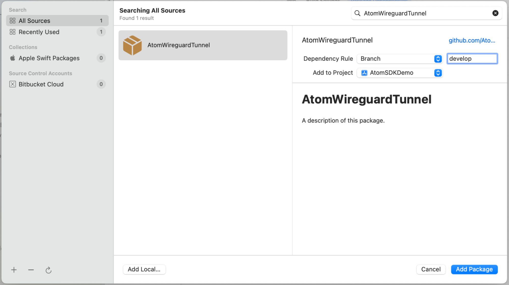
17. Now you need to install Go into your mac. To install this, open https://go.dev/doc/install. Click on Other Downloads. Go to archived versions. Click on 1.16 or 1.19 and download this go1.16.darwin-amd64.pkg.
    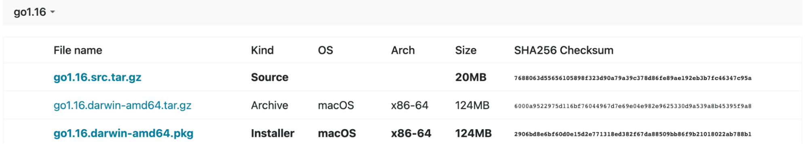
18. Now open the terminal and write ‘which go’ command. It will show a path where go 1.16 is installed (like /usr/local/go/bin/go).
19. Go to Project navigator in Xcode. Open Package Dependencies and expand WireguardKit. In the Sources folder, expand WireguardKitGo and right click on Makefile to open it in the finder.
    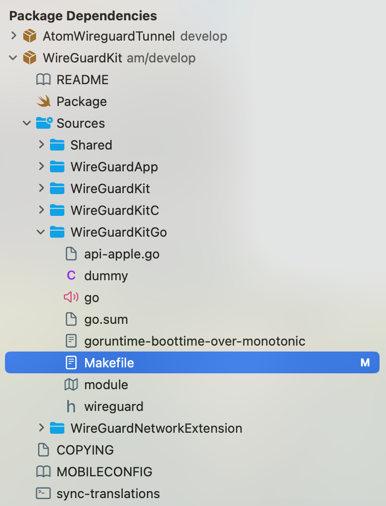
20. In line no 13, replace
    **export PATH := $(PATH):/usr/local/bin:/opt/homebrew/bin:**
    with
    **export PATH := $(PATH):/usr/local/bin:/opt/homebrew/bin:/usr/local/go/bin**
    and save it.
21. Copy the bridging file from SupportingFiles of Demo Project and place it into your root directory or SupportingFiles folder of your xcode project.
22. Go to project settings, add a new target by selecting the **Other** section.
    Select **External Build System** and click Next. Define a Product Name like **WireguardiOS** and select the same team on which all three targets are configured.
    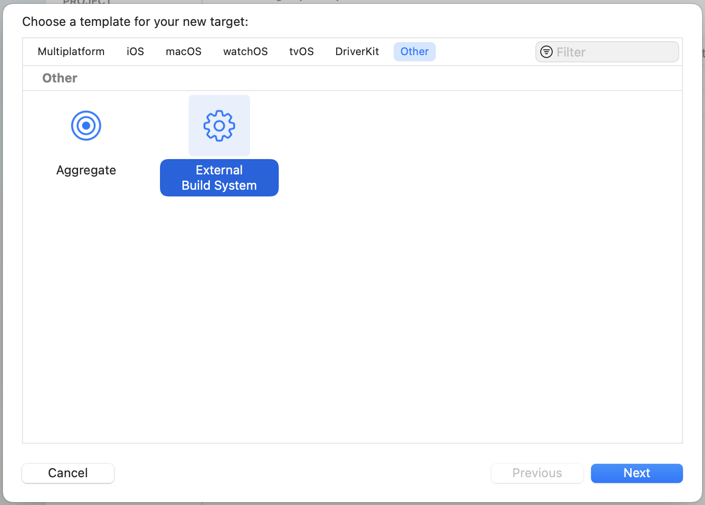
23. In the **Build Tool**, add **$(SRCROOT)/AtomSDKDemo/build_wireguard_go_bridge.sh** for bridging between Go and Network Extension for WireGuard. Click on finish to add this target into your project.
    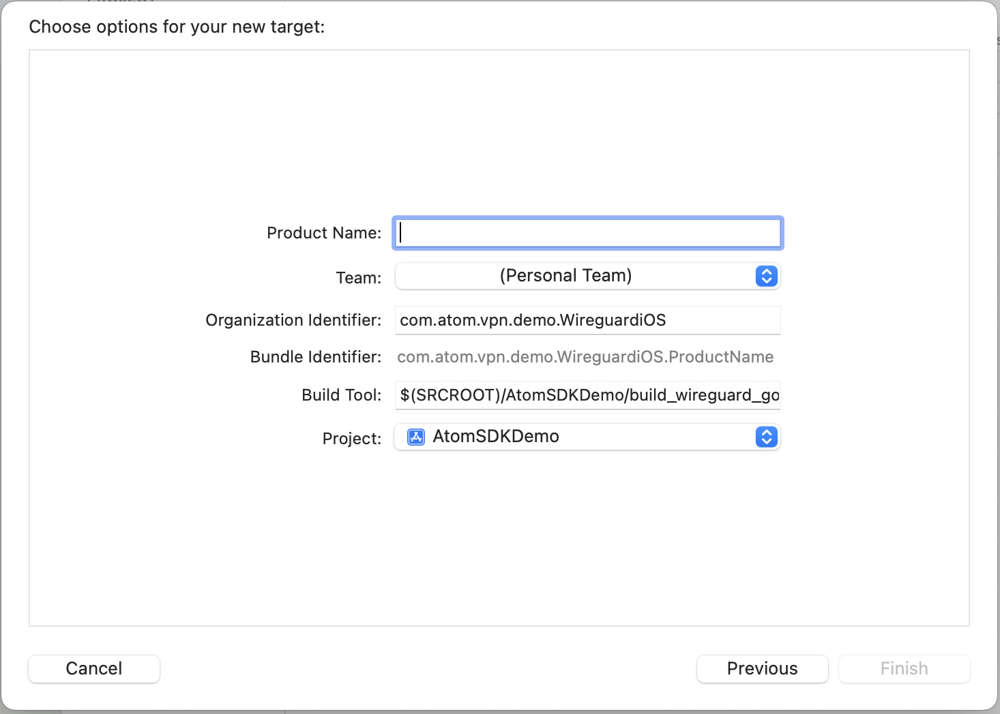
24. Go to your **WireguardNetworkExtension** target and select the **Build Phases** section. In **Target Dependencies** add **WireguardiOS** (External Build System just created above).
    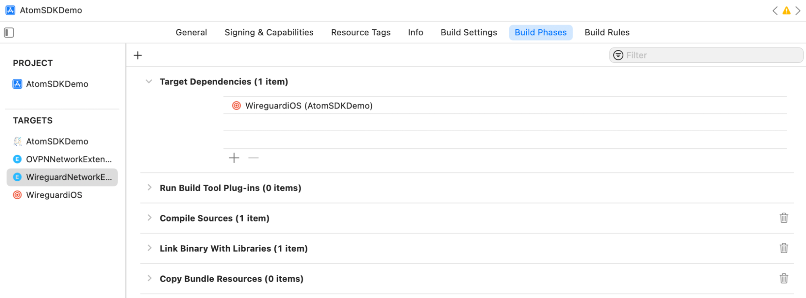
25. Now select main project settings and go to **Build settings**. Click on + Icon and add ‘**Add user-defined Setting**’. Replace **NEW_SETTING** with **PATH** and in its input field, write **$PATH:/usr/local/go/bin**
    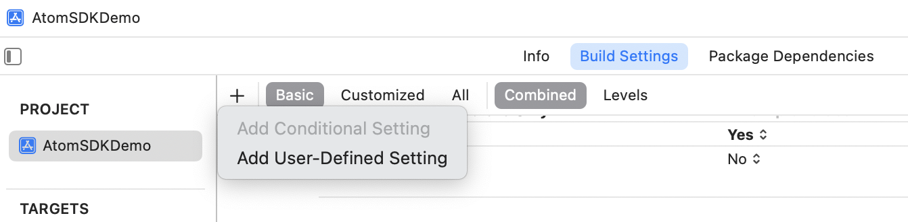
    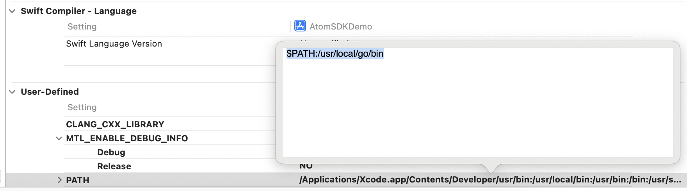
26. Go to project settings and select **WireguardNetworkExtension** target. Click on + icon in **Framework and Libraries** section. Add **AtomWireguardTunnel** Library.
    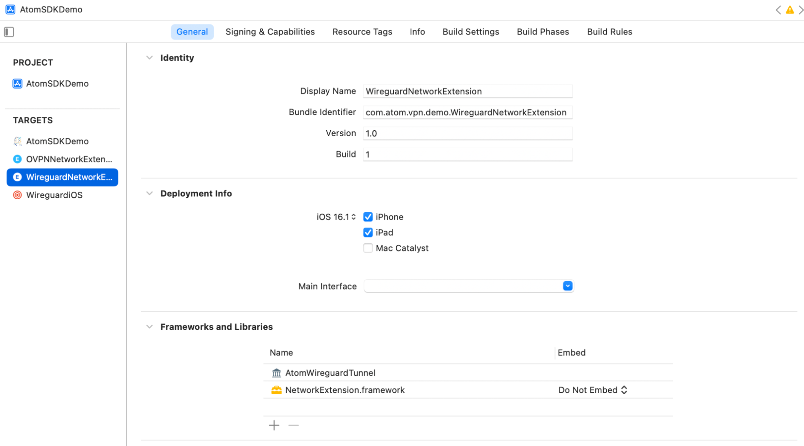
27. These are some minor steps to configure both network extensions with your vpn app. Now expand **OvpnNetworkExtension** Folder in your project navigator. Open **PacketTunnelProvider.swift** file. Import **AtomSDKTunnel** and inherit **PacketTunnelProvider** class with **AtomSDKTunnelProvider** class.
    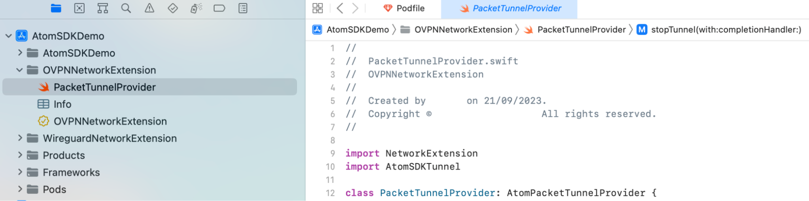
28. Add following line of code into **startTunnel** function in **PacketTunnelProvider** Class for **OvpnNetworkExtension** Folder
    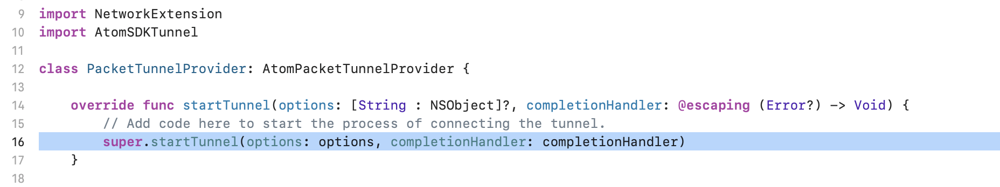
29. Expand the **WireguardNetworkExtension** folder in your project navigator and open **PacketTunnelProvider.swift** file. Import **AtomWireguardTunnel** and **AtomWireguardAppExtension**. Inherit **PacketTunnelProvider** class with **WireguardPacketTunnelProvider**.
    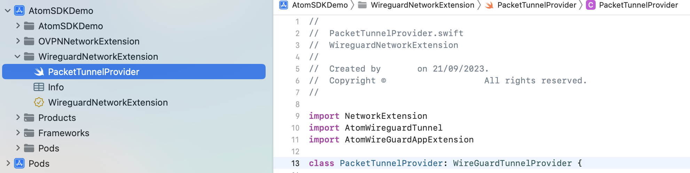
30. Add following line of code into **startTunnel** function in **PacketTunnelProvider** Class for **WireguardNetworkExtension** Folder.
    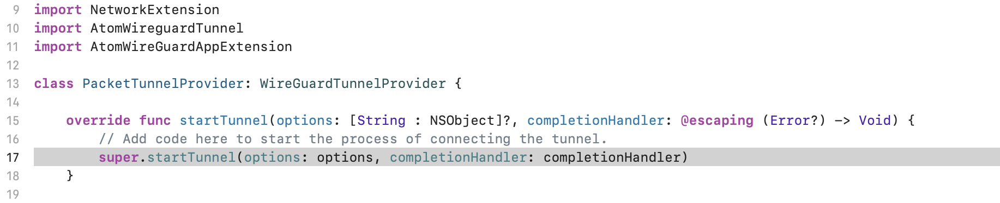

AtomSDK can be initialized using an instance of AtomConfiguration. It should have a vpnInterfaceName which will be used to create the Network Interface for VPN connection. Also, there is tunnelProviderBundleIdentifier in which you have to enter the bundle ID of Network Extension of your project.

```ruby
AtomConfiguration *atomConfiguration = [[AtomConfiguration alloc] init];
atomConfiguration.secretKey = @"SECRETKEY_GOES_HERE";
atomConfiguration.vpnInterfaceName = @"Atom";
atomConfiguration.tunnelProviderBundleIdentifier = @"ENTER_YOUR_OPENVPN_NETWORK_EXTENSION_BUNDLE_ID";
atomConfiguration.wireGuardTunnelProviderBundleIdentifier = @"ENTER_YOUR_WIREGUARD_NETWORK_EXTENSION_BUNDLE_ID";
[AtomManager sharedInstanceWithAtomConfiguration:atomConfiguration];
```

## SDK features covered in this demo
* Connection with Parameters
* Connection with Dedicated IP
* Connection with Multiple Protocols (Auto-Retry Functionality)

## Supported Protocols
* **WireGuard:** Fast, modern VPN protocol. (Recommended by SDK)
* **OpenVPN - UDP:** Fast VPN connection for lower latency and better performance.
* **IKEv2:** Secure VPN protocol designed for fast and stable connections.
* **IPSec:** Widely supported VPN protocol built into iOS.
* **OpenVPN - TCP:** Reliable VPN connection for better stability on restrictive networks.

## Getting started with the code

To add the SDK in Xcode:

1. Open your Xcode project.
2. Add your developer account to Xcode from Preferences -> Account if you didn't add before.
3. Select General tab from your app target and then set your developer account details.
4. From your app target select Capabilities tab and select the switch right of the Personal VPN. Then select the capabilities you are going to use.
5. Drag and drop AtomSDK.framework into your project. (Skip if using CocoaPods)
6. Go to your project -> General tab from your app target, add the framework using ‘+’ to the Embedded Binaries section. (Skip if using CocoaPods)
7. After the setup is completed, you should be able to use all the classes from the SDK by including it with the #import <AtomSDK/AtomSDK.h> directive.
8. ATOM SDK needs to be initialized with a “SecretKey” provided to you after you buy the subscription which is typically a hex-numeric literal.

It can be initialized using an instance of AtomConfiguration. It should have a vpnInterfaceName which will be used to create the Network Interface for VPN connection.

```ruby
    AtomConfiguration *atomConfiguration= [[AtomConfiguration alloc] init];
    atomConfiguration.secretKey = @"SECRETKEY_GOES_HERE";
    atomConfiguration.vpnInterfaceName = @"Atom";
    atomConfiguration.tunnelProviderBundleIdentifier = @"ENTER_YOUR_NETWORK_EXTENSION_BUNDLE_ID";
    atomConfiguration.wireGuardTunnelProviderBundleIdentifier = @"ENTER_YOUR_WIREGUARD_NETWORK_EXTENSION_BUNDLE_ID";

    [AtomManager sharedInstanceWithAtomConfiguration:atomConfiguration];
```

`Note:` ATOM SDK is a singleton, and must be initialized before accessing its methods.

### Enable Local Inventory support

ATOM SDK offers a feature to enable the local inventory support. This can help application to fetch Countries and Protocols even when device network is not working.

* To enable it, Log In to the Atom Console
* Download the local data file in json format
* File name should be localdata.json. Please rename the file to localdata.json if you find any discrepancy in the file name.
* Paste the file in root of your application folder.

### VPN Authentication

ATOM SDK provides one way to authenticate your VPN user: by passing VPN credentials directly to the SDK. You can create these credentials through the Admin Panel provided by ATOM.

```ruby
[AtomManager sharedInstance].atomCredential = [[AtomCredential alloc] initWithUsername:@"<username>" password:@"<password>"];
```

### Delegates to register

ATOM SDK offers a few delegates to register for the ease of developers.

* atomManagerDidInitialized:
* atomManagerDidConnecting:
* atomManagerDidConnect:
* atomManagerDidPaused:
* atomManagerDidDisconnect:
* atomManagerOnRedialing:
* atomManagerDialErrorReceived:
* atomManagerOnUnableToAccessInternet:
* atomManagerDidReceivedConnectedLocation:

To receive these callbacks, set the delegate on AtomManager:
```ruby
[AtomManager sharedInstance].delegate = self;
```

Details of these delegates can be seen in the inline documentation or method summaries. In order to monitor the current state of the VPN connection, ATOM SDK also offers `stateDidChangedHandler` on AtomManager.

```ruby
[AtomManager sharedInstance].stateDidChangedHandler = ^(AtomVPNState status) { };
```

### Persist VPN Details
By default ATOM SDK keeps the details of the current VPN session in memory only, so they are lost when the application process is killed. Enabling this option makes the SDK store the last session's `AtomConnectionDetails` and `AtomProperties` in the application's private storage, so they are still available after the application restarts.

Enable it on the `AtomConfiguration` at initialization:
```ruby
atomConfiguration.persistVPNDetails = YES;
```

With the option enabled, both of the following keep returning the last known session after a process restart. With it disabled, they only reflect a session established in the current process.
```ruby
connectionDetails = atomManager.atomConnectionDetails;
properties = atomManager.atomProperties;
```

## VPN Connection

You need to declare an object of “AtomProperties” Class to define your connection preferences. Details of all the available properties can be seen in the inline documentation of “AtomProperties” Class. For the least, you need to give Country and Protocol with which you want to connect.

```ruby
AtomProperties* properties = [[AtomProperties alloc] initWithCountry:@"<country>" protocol:@"<protocol>"];
```

### Fetch Recommended Location

You can get the Recommended Location for user's location through ATOM SDK.

```ruby
[[AtomManager sharedInstance] getRecommendedLocation:^(AtomLocation * _Nullable location) {
} errorBlock:^(NSError * _Nullable error) {
}];
```

### Recommended Protocol

If you do not specify the protocol in case of Country, City and Channel dialing then Atom SDK dials with recommended protocol according to the specified country, city and channel.

for example:

**Country:**
```ruby
AtomProperties* properties = [[AtomProperties alloc] initWithCountry:@"<country>" protocol:nil];
```
**City:**
```ruby
AtomProperties* properties = [[AtomProperties alloc] initWithCity:@"<city>" protocol:nil];
```
**Channel:**
```ruby
AtomProperties* properties = [[AtomProperties alloc] initWithChannel:@"<channel>" protocol:nil];
```

`Note:` *Recommended protocol will not work for dedicated IP*.

### Fetch Countries

Countries can be obtained through ATOM SDK.

```ruby
[[AtomManager sharedInstance] getCountriesWithSuccess:^(NSArray<AtomCountry *> *success) {}
errorBlock:^(NSError *error) {}];
```

### Fetch Optimized Countries
You can get all the countries available to you, sorted by real-time latency from your user's network. The ATOM SDK pings our datacenters from the user's device and sets the `latency` property on each `AtomCountry` object to the lowest latency measured among that country's datacenters.

```ruby
[[AtomManager sharedInstance] getOptimizedCountriesWithSuccess:^(NSArray<AtomCountry *> *optimizedCountriesList) {
    // optimizedCountriesList is already sorted: lowest latency first
    for (AtomCountry *country in optimizedCountriesList) {
        NSLog(@"%@ - %ld", country.name, (long)country.latency);
    }
} errorBlock:^(NSError *error) {}];
```

**Things to know:**
* The list comes back already sorted, lowest latency first. You don't need to sort it yourself.
* A `latency` of `0` means the country could not be measured. This can happen when ping (ICMP) is blocked on the user's network, or when the ISP blocks some of our datacenters. These countries are placed at the **end** of the list. Do not treat `0` as the fastest.

### Fetch Protocols

Protocols can be obtained through ATOM SDK.

```ruby
[[AtomManager sharedInstance] getProtocolsWithSuccess:^(NSArray<AtomProtocol *> *success) {}
errorBlock:^(NSError *error) {}];
```

### Protocol Switch

You can enable or disable protocol switch from AtomProperties class. It is `true` by default.

```ruby
properties.enableProtocolSwitch = false;
```

or

```ruby
properties.enableProtocolSwitch = true;
```

### Use Failover

Failover is a mechanism in which Atom dials the nearest server if requested server is busy or not found for any reason. You can control this mechanism from AtomProperties class. It is `true` by default.

```ruby
properties.useFailover = false;
```

or

```ruby
properties.useFailover = true;
```

### LAN (Local Area Network)

Atom SDK includes a feature that enables users to access their locally connected devices over the internet while maintaining an active VPN connection. This functionality ensures seamless connectivity to local resources without compromising security. By default, VPN connections restrict access to locally connected devices. However, our SDK introduces the `allowLocalNetworkTraffic` property within the `AtomProperties` class, allowing users to toggle this capability on/off.

In order to turn `ON` Allow LAN, please use as follows before the connection in Atom Properties:

```ruby
atomProperties.featureFlagAllowLocalNetworkTraffic = true
atomProperties.allowLocalNetworkTraffic = true
```

In order to turn `OFF` Allow LAN, please use as follows before the connection in Atom Properties:

```ruby
atomProperties.featureFlagAllowLocalNetworkTraffic = false
atomProperties.allowLocalNetworkTraffic = false
```

The following property is available in the connection details related to this feature:

- `isAllowLocalNetworkTrafficRequested`: Returns a boolean indicating whether the LAN access is requested.

`Note:` The LAN access feature is available from `iOS 14.2` and `macOS 10.15`.

### How to Connect

As soon as you call Connect method, the delegates you are listening to will get the updates about the states being changed and VPNDialedError (if any occurs) as well.

After initializing the AtomProperties, just call Connect method of ATOM SDK.

#### Connection with Parameters

It is the simplest way of connection which is well explained in the steps above. You just need to provide the country and the protocol objects and call the Connect method.

```ruby
AtomProperties* properties = [[AtomProperties alloc] initWithCountry:@"<#country#>" protocol:@"<#protocol#>"];

[[AtomManager sharedInstance] connectWithProperties:properties completion:^(NSString *success) {}
errorBlock:^(NSError *error) {}];
```

#### Include or Exclude Server with Nas Identifier

When connecting with parameters, a server can be included or excluded with its Nas Identifier

```ruby
AtomProperties* properties = [[AtomProperties alloc] initWithCountry:@"<#country#>" protocol:@"<#protocol#>"];
NSMutableArray<ServerFilter *> *serverFilters = [NSMutableArray new];
[serverFilters addObject:[[ServerFilter alloc] initWithNasIdentifier:@"nas-identifier-here" andFilter:INCLUDE]];
[serverFilters addObject:[[ServerFilter alloc] initWithNasIdentifier:@"nas-identifier-here" andFilter:EXCLUDE]];
[properties setServerFilters:serverFilters];
[[AtomManager sharedInstance] connectWithProperties:properties completion:^(NSString *success) {}
errorBlock:^(NSError *error) {}];
```

#### Connection with Dedicated IP

You can also make your user comfortable with this type of connection by just providing them with a Dedicated IP/Host and they will always connect to a dedicated server! For this purpose, ATOM SDK provides you with the following constructor.

```ruby
AtomProperties *properties = [[AtomProperties alloc] initWithDedicatedHostName:@"<#DedicatedIP/Host#>" protocol:@"<#protocol#>"];

[[AtomManager sharedInstance] connectWithProperties:properties completion:^(NSString *success) {}
errorBlock:^(NSError *error) {}];
```

#### Connection with Multiple Protocols (Auto-Retry Functionality)

You can provide three protocols at max so ATOM SDK can attempt automatically on your behalf to get your user connected with the Secondary or Tertiary protocol if your base Protocol fails to connect.

```ruby
properties.secondaryProtocol = @"<protocol2>";
properties.tertiaryProtocol = @"<protocol3>";
```

#### Connection with On Demand Custom Rules

On Demand Custom Rules allow you to configure automatic VPN connection and disconnection based on network conditions, Wi-Fi SSIDs, DNS settings, and other network parameters. This feature provides fine-grained control over when the VPN should automatically connect or disconnect.

##### Key Properties

The On Demand Custom Rules feature is controlled through the `AtomOnDemandConfiguration` class with two main properties:

1. **isOnDemandCustomRulesEnabled** (BOOL): A boolean flag that enables or disables the use of custom On-Demand VPN rules. When set to `YES`, the SDK will apply the rules provided in `OnDemandCustomRules`. Default value is `NO`.
2. **OnDemandCustomRules** (NSArray): An array of `AtomOnDemandRule` objects representing custom On-Demand VPN rules. These rules are applied automatically by the SDK when `isOnDemandCustomRulesEnabled` is set to `YES`.

##### Rule Types

ATOM SDK supports four types of On-Demand rules:

1. **AtomOnDemandConnectRule**: Automatically connects the VPN when the rule conditions are met.
2. **AtomOnDemandDisconnectRule**: Automatically disconnects the VPN when the rule conditions are met.
3. **AtomOnDemandIgnoreRule**: Leaves the VPN connection state unchanged when the rule matches.
4. **AtomOnDemandEvaluateConnectionRule**: Evaluates network connections and determines whether the VPN should connect based on defined connection rule items.

##### Integration Steps

**Step 1: Create On-Demand Configuration**
Create an instance of `AtomOnDemandConfiguration` and enable custom rules:

```ruby
AtomOnDemandConfiguration *onDemandConfiguration = [[AtomOnDemandConfiguration alloc] init];
onDemandConfiguration.onDemandRulesEnabled = YES;
onDemandConfiguration.isOnDemandCustomRulesEnabled = YES;
```

**Step 2: Create Custom Rules**
Create the desired rule objects and add them to the configuration:

```ruby
// Example: Connect rule for specific Wi-Fi SSIDs
AtomOnDemandConnectRule *connectRule = [[AtomOnDemandConnectRule alloc] 
    initWithSSIDMatch:@[@"PublicWiFi", @"AirportWiFi"] 
    interfaceType:AtomOnDemandInterfaceTypeWifi];

// Example: Disconnect rule for trusted Wi-Fi networks
AtomOnDemandDisconnectRule *disconnectRule = [[AtomOnDemandDisconnectRule alloc] 
    initWithSSIDMatch:@[@"HomeWiFi", @"OfficeWiFi"] 
    interfaceType:AtomOnDemandInterfaceTypeWifi];

// Example: Ignore rule to maintain VPN state on specific networks
AtomOnDemandIgnoreRule *ignoreRule = [[AtomOnDemandIgnoreRule alloc] 
    initWithSSIDMatch:@[@"GuestNetwork"] 
    interfaceType:AtomOnDemandInterfaceTypeWifi];

// Add rules to configuration
onDemandConfiguration.OnDemandCustomRules = @[connectRule, disconnectRule, ignoreRule];
```

**Step 3: Apply Configuration**
Set the configuration to AtomManager and update it:

```ruby
[[AtomManager sharedInstance] setOnDemandConfiguration:onDemandConfiguration];
[[AtomManager sharedInstance] updateOnDemandVpnStatusWithCompletion:^(NSString * _Nullable success) {
    NSLog(@"On Demand Custom Rules updated successfully");
} errorBlock:^(NSError * _Nullable error) {
    NSLog(@"Error updating On Demand Rules: %@", error.localizedDescription);
}];
```

##### Advanced Rule Configuration

**Rule with DNS Settings**
You can configure rules with DNS search domains and DNS server addresses:

```ruby
AtomOnDemandConnectRule *connectRule = [[AtomOnDemandConnectRule alloc] 
    initWithSSIDMatch:nil 
    interfaceType:AtomOnDemandInterfaceTypeAny];
connectRule.dnsSearchDomains = @[@"example.com", @"internal.company.com"];
connectRule.dnsServerAddresses = @[@"8.8.8.8", @"8.8.4.4"];
connectRule.probeURL = [NSURL URLWithString:@"https://www.example.com/probe"];
```

**Evaluate Connection Rule**
Use `AtomOnDemandEvaluateConnectionRule` for more complex scenarios where you need to evaluate connections to specific domains:

```ruby
AtomOnDemandEvaluateConnectionRuleItem *ruleItem = [[AtomOnDemandEvaluateConnectionRuleItem alloc] 
    initWithMatchDomains:@[@"restricted-site.com", @"blocked-domain.com"] 
    action:AtomOnDemandEvaluateConnectionRuleActionConnectIfNeeded 
    dnsServers:@[@"1.1.1.1"] 
    probeURL:[NSURL URLWithString:@"https://www.example.com/connectivity-check"]];

AtomOnDemandEvaluateConnectionRule *evaluateRule = [[AtomOnDemandEvaluateConnectionRule alloc] 
    initWithConnectionRules:@[ruleItem] 
    interfaceType:AtomOnDemandInterfaceTypeAny];

onDemandConfiguration.OnDemandCustomRules = @[evaluateRule];
```

##### Interface Types

Rules can be applied to different network interfaces:

- `AtomOnDemandInterfaceTypeAny`: Applies to any network interface (default)
- `AtomOnDemandInterfaceTypeWifi`: Applies only to Wi-Fi connections
- `AtomOnDemandInterfaceTypeCellular`: Applies only to cellular connections (iOS only)
- `AtomOnDemandInterfaceTypeEthernet`: Applies only to Ethernet connections (macOS/tvOS only)

**Note:** The interface type enum values are exposed from Swift to Objective-C. Use the full enum name as shown in the examples above.

##### Complete Example

Here's a complete example showing how to set up On Demand Custom Rules:

```ruby
// Create and configure On-Demand settings
AtomOnDemandConfiguration *onDemandConfiguration = [[AtomOnDemandConfiguration alloc] init];
onDemandConfiguration.onDemandRulesEnabled = YES;
onDemandConfiguration.isOnDemandCustomRulesEnabled = YES;

// Create rules array
NSMutableArray *rules = [NSMutableArray new];

// Rule 1: Connect VPN on untrusted Wi-Fi networks
AtomOnDemandConnectRule *connectRule = [[AtomOnDemandConnectRule alloc] 
    initWithSSIDMatch:@[@"PublicWiFi", @"CoffeeShop"] 
    interfaceType:AtomOnDemandInterfaceTypeWifi];
[rules addObject:connectRule];

// Rule 2: Disconnect VPN on trusted Wi-Fi networks
AtomOnDemandDisconnectRule *disconnectRule = [[AtomOnDemandDisconnectRule alloc] 
    initWithSSIDMatch:@[@"HomeNetwork", @"OfficeNetwork"] 
    interfaceType:AtomOnDemandInterfaceTypeWifi];
[rules addObject:disconnectRule];

// Rule 3: Connect VPN on cellular networks
AtomOnDemandConnectRule *cellularRule = [[AtomOnDemandConnectRule alloc] 
    initWithSSIDMatch:nil 
    interfaceType:AtomOnDemandInterfaceTypeCellular];
[rules addObject:cellularRule];

// Set rules
onDemandConfiguration.OnDemandCustomRules = rules;

// Apply configuration
[[AtomManager sharedInstance] setOnDemandConfiguration:onDemandConfiguration];
[[AtomManager sharedInstance] updateOnDemandVpnStatusWithCompletion:^(NSString * _Nullable success) {
    NSLog(@"On Demand Custom Rules updated successfully");
} errorBlock:^(NSError * _Nullable error) {
    NSLog(@"Error updating On Demand Rules: %@", error.localizedDescription);
}];
```

##### Important Notes

- Rules are evaluated in the order they are added to the `OnDemandCustomRules` array.
- If `SSIDMatch` is `nil` or empty, the rule applies to all networks of the specified interface type.
- The `probeURL` is used to test connectivity before applying connection rules.
- Ensure that `onDemandRulesEnabled` is set to `YES` for any On-Demand functionality to work.

For more information, please see the inline documentation of `AtomOnDemandConfiguration` and `AtomOnDemandRule` classes.

For more information on all connection types, please see the inline documentation of AtomProperties class.

## Cancel VPN Connection

You can cancel connection between dialing process by calling the cancelVPN method.

```ruby
[[AtomManager sharedInstance] cancelVPN];
```

## Disconnect VPN Connection

To disconnect, simply call the disconnectVPN method of AtomManager.

```ruby
[[AtomManager sharedInstance] disconnectVPN];
```

## Remove VPN Profile

To remove VPN profile, simply call the removeVPNProfileWithCompletion method of AtomManager.

```ruby
[[AtomManager sharedInstance] removeVPNProfileWithCompletion:^(BOOL isSuccess) {
}];
```

---

## Tracker / Ad Blocker
This feature enables VPN applications built with the Atom SDK to block tracking scripts and advertisements, enhancing both **privacy** and **performance**.

### Overview
As a VPN service provider, we offer a robust SDK that allows our clients to build custom VPN applications. We have introduced support for Tracker and Ad Blocker functionality. When enabled, this will actively block trackers and advertisements during the VPN session. It is supported across all connection types provided by the SDK:

1. Connect with Params
2. Connect with Dedicated IP
3. Connect with Multiple Dedicated IPs
4. Connect with Dedicated VPS

### Enabling Tracker / Ad Blocker
To enable the Tracker and Ad Blocker while the VPN is connected, pass the feature list in `AtomProperties` when connecting, as shown below:
```
properties.atomShieldFeatureList = [
    NSNumber(value: AtomShieldFeature.TRACKER_AND_AD_BLOCKER.rawValue)
]
```
To disable AtomShield, pass an empty list (or `nil`).

From Atom SDK version **6.12.0** onwards, the Tracker and Ad Blocker offerings are combined into a single option — `TRACKER_AND_AD_BLOCKER` — that enables (or disables) both together and maximizes privacy during the VPN session.

**NOTE:** On Atom SDK versions **before 6.12.0**, the two were opted into separately as `AtomShieldFeature.TRACKER` and `AtomShieldFeature.AD_BLOCKER`. Both were replaced by `TRACKER_AND_AD_BLOCKER` in 6.12.0, so code still referencing them will not compile against 6.12.0 or later.

### Observe Connection Status and Data
To receive callbacks, set the atomShieldDelegate on AtomManager:
```ruby
[AtomManager sharedInstance].atomShieldDelegate = self;
```

To monitor status and data updates, register the `AtomShieldDelegate`:
```
private static var atomShieldStateListener: AtomShieldStateListener!
atomShieldStateListener = AtomShieldStateListener()
atomManager.atomShieldDelegate = atomShieldStateListener
```
The delegate includes two methods for observing Tracker / Ad Blocker connection status and stats:

- **Status Updates:** `onAtomShieldStatusChange(status: AtomShieldStatus, error: NSError?, message: String?)`
- **Data Updates:** `onAtomShieldDataReceived(data: AtomShieldData?)`

```
class AtomShieldStateListener: NSObject, AtomShieldManagerDelegate {
    func onAtomShieldStatusChange(status: AtomShieldStatus, error: NSError?, message: String?) {
        print("Status: \(status), Error: \(String(describing: error)), Message: \(String(describing: message))")
    }

    func onAtomShieldDataReceived(data: AtomShieldData?) {
        print("Blocked Count: \(String(describing: data?.getTotalCount()))")
    }
}
```

**Status Updates (AtomShieldStatus)**

| Status                         | Status Params                                                         | Description                                           |
| ------------------------------ | --------------------------------------------------------------------- | ----------------------------------------------------- |
| **Establishing(String)** | [String] Provide the Tracker/Ad Blocker establishing message.         | Connecting the Tracker/Ad Blocker.                    |
| **Established(String)**  | [String] Provide the Tracker/Ad Blocker established message.          | Tracker/Ad Blocker successfully connected.            |
| **Disconnected(String)** | [String] Provide the Tracker/Ad Blocker disconnected message.         | Tracker/Ad Blocker disconnected.                      |
| **Error(AtomException)** | [AtomException] Provide the Tracker/Ad Blocker exception information. | An error occurred. See error codes below for details. |

### Troubleshooting:
Following are the error details for this feature:

| Error Code | Error Message                               | Description                                                                                                                                                                              |
| :--------: | ------------------------------------------- | ---------------------------------------------------------------------------------------------------------------------------------------------------------------------------------------- |
|    5179    | Connection type does not support AtomShield | When the VPN connection other than Params, Dedicated IP, Multiple Dedicated IPs and Dedicated VPS.                                                                                       |
|    5180    | Unable to establish AtomShield connection   | When the specified retry count has been attempted to the tracker blocker socket connection.                                                                                              |
|    5181    | Unable to make request to AtomShield server | When sending request to socket server but socket connection lost/not established OR socket connection closed OR When unexpectedly fails the request Or When VPN disconnected gracefully. |
|    5182    | Unable to enable AtomShield connection      | When request to enable tracker/ad blocker service returns failure from server.                                                                                                           |
|    5183    | Unable to get AtomShield stats              | When requested to get the stats of tracker/ad blocker service from the server.                                                                                                           |

**Data Updates (AtomShieldData)**

`AtomShieldData` provides `getTotalCount()`, which returns the cumulative number of blocked trackers and ads.

```
data?.getTotalCount() // Number of trackers/ads blocked
```

### Tracker / Ad Blocker Information in Connection Details:
The following property is available in the connection details related to this feature:
- `isTrackerAndAdBlockerRequested`: Returns a boolean indicating whether the Tracker and Ad Blocker was requested.

```
atomConnectionDetails.isTrackerAndAdBlockerRequested
```

**NOTE:** The Tracker / Ad Blocker connection will be established upon successful VPN Connection.

---

## Network Traffic Updates

For VPN connection speed you need to register onPacketsTransmitted handler from AtomManager class to get the VPN connection speed in bytes per second. This callback is received only in VPN connected state.

```ruby
AtomManager.sharedInstance.onPacketsTransmitted = ^(NSNumber *bytesReceived, NSNumber *bytesSent) {
    NSLog(@"bytesIN: %ld | bytesOUT: %ld ", (long)bytesReceived.integerValue, (long)bytesSent.integerValue);
};
```

---

## Pause / Resume VPN Connection
This feature allows users to temporarily pause VPN connections for a specified duration. Useful when users need to suspend VPN activity without fully disconnecting.

The VPN Pause feature enables pausing a VPN connection under specific conditions and supports one mode:
- **Timed Pause:** Pauses the VPN connection for a predefined duration, automatically resuming once the timer expires. Users also have the option to manually resume the connection before the timer completes.

### Key Rules and Conditions:
1. VPN can be paused only when it is in Connected state.
2. VPN can be resumed only when it is in Paused state.
3. A paused VPN can still be disconnected using the SDK's Disconnect method.
4. During a timed pause, users can manually resume the VPN at any time using the Resume method.

### Setup Tunnel Delegates:

#### startTunnel:

This delegate is being invoked when the VPN enters a start state. Implement this delegate in PacketTunnelProvider.swift.

```
override func startTunnel(options: [String : NSObject]?, completionHandler: @escaping (Error?) -> Void) {
    super.startTunnel(options: options, completionHandler: completionHandler)
}
```

#### stopTunnel:

This delegate is being invoked when the VPN enters a stop state. Implement this delegate in PacketTunnelProvider.swift.

```
override func stopTunnel(with reason: NEProviderStopReason, completionHandler: @escaping () -> Void) {
    super.stopTunnel(with: reason, completionHandler: completionHandler)
}
```

#### handleAppMessage:

This delegate is being invoked for the communication between app and tunnel. Implement this delegate in PacketTunnelProvider.swift.

```
override func handleAppMessage(_ messageData: Data, completionHandler: ((Data?) -> Void)? = nil) {
    super.handleAppMessage(messageData, completionHandler: completionHandler)
}
```

### Pause VPN delegation:
This delegate is being invoked when the VPN enters a pause state. Implement this delegate to handle any pause-specific operations.

```
func atomManagerDidPaused(_ atomConnectionDetails: AtomConnectionDetails?) {
	//
}
```

The `atomManagerDidPaused` delegate provides one argument:
- **ConnectionDetails:** Contains information related to the current VPN connection.

### Pause / Resume VPN Connection
To pause the VPN connection, use the following method. It pauses the VPN connection based on the interval provided:

```
AtomManager.sharedInstance()?.pause(with: .MINUTES_5, withCompletion: { error in
	//
})
```

To resume the VPN connection, invoke:

```
AtomManager.sharedInstance()?.resume(completion: { error in
	//
})
```

The `resume` method will resume the VPN connection if it is currently in the paused state. On a successful resume, the `atomManagerDidConnect` delegate will be triggered. If an error occurs during the resume process, the `atomManagerDialErrorReceived` delegate will be invoked.

```
func atomManagerDidConnect(_ atomConnectionDetails: AtomConnectionDetails?) {
	//
}

func atomManagerDialErrorReceived(_ error: Error?, with atomConnectionDetails: AtomConnectionDetails?) {
	//
}
```

The available options for `PauseVPNTimer` include various predefined timed durations (e.g., 5, 10, 15 and 20 minutes), as defined in the enum shown below.

```
enum PauseVPNTimer 
{
    MINUTES_5, MINUTES_10, MINUTES_15, MINUTES_20
}
```

### VPN State Management:
The SDK provides additional VPN statuses

- **PAUSING**
- **PAUSED**

You can request the current VPN state using the following method:

```
AtomManager.sharedInstance()?.getCurrentVPNStatus()
```

### Handle State Changes:
SDK also provides all VPN states via `StateDidChangedHandler` as below

```
AtomManager.sharedInstance()?.stateDidChangedHandler = AtomStateListener().stateChanged

fileprivate let stateChanged: StateDidChangedHandler = { atomState in
	//
}
```

### Pause/Resume Information in Connection Details:
The following properties are available in the connection details related to this feature:
- `pauseVPNTimer`: Returns a `PauseVPNTimer`, indicating the duration for which the VPN is paused.
- `isVPNAutoResumed`: Returns a boolean indicating whether the VPN was resumed manually or automatically after the pause timer expired.

### Error Handling:
Following are the error details for this feature:

| Error Code | Error Message                                                    | Description                                                                                              |
| :--------: | ---------------------------------------------------------------- | -------------------------------------------------------------------------------------------------------- |
|    5194    | Unable to resume, the VPN connection is not in a paused state.   | If VPN is not PAUSED and try to resume vpn, the error occurs and is notified via resume method.          |
|    5195    | Unable to pause, the VPN connection is not in a connected state. | If VPN is NOT connected and try to pause vpn, the error occurs and is notified via pause method.         |
|    5197    | Unable to pause, connected protocol is not supported.            | If connected protocol is not supported for pause VPN, the error occurs and is notified via pause method. |
|    5198    | Unable to pause, VPN is already paused.                          | When try to pause VPN that is already paused, the error occurs and is notified via pause method.         |
|    5199    | Unable to perform operation, invalid tunnel connection.          | Error occurred when trying to Pause/Resume connection while tunnel connection is not valid.              |
|    5200    | Unable to perform operation, no response.                        | Error occurred when trying to Pause/Resume connection while no response occurred.                        |
|    5201    | Unable to perform operation, invalid response.                   | Error occurred when trying to Pause/Resume connection while invalid response occurred.                   |

---

## Note

The current version of the VPN Atom SDK uses the following library under the hood:

* NEVPNManager
* NEVPNTunnelProvider
